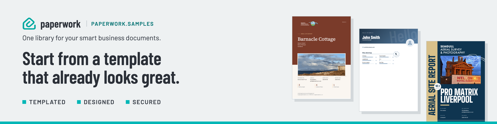

<picture>
  <source media="(prefers-color-scheme: dark)" srcset=".github/images/banner-dark.png">
  
</picture>

<p align="center">
  <a href="https://github.com/richard-scryber/scryber.core">Scryber</a> |
  <a href="https://github.com/paperwork-collective/Paperwork.Core">Core</a> |
  <a href="https://www.nuget.org/packages/Paperwork.CLI">CLI</a> |
  <a href="https://github.com/paperwork-collective/Paperwork.Skill">Skill</a> |
  <a href="https://paperwork.design" target="_blank" rel="noopener">Design</a> |
  <a href="https://paperwork.vu" target="_blank" rel="noopener">View</a> |
  <a href="https://paperwork.help" target="_blank" rel="noopener">Help</a> |
  <a href="https://www.paperwork-collective.com" target="_blank" rel="noopener">Corp</a>
</p>

# Paperwork.Samples

**Start from a template that already looks great.**

Paperwork.Samples holds the designs and template code from the help files at [paperwork.help](https://paperwork.help): the templates, styles and data each guide uses, ready for you to run and adapt. Generate from them with [Paperwork.Core](https://github.com/paperwork-collective/Paperwork.Core) or the [CLI](https://www.nuget.org/packages/Paperwork.CLI).

## The Paperwork family

| | What it's for |
|---|---|
| [Scryber.Core](https://github.com/richard-scryber/scryber.core) | The open-source generation engine: templates, and code to create a document. |
| [Paperwork.Core](https://github.com/paperwork-collective/Paperwork.Core) | Embedding generation in your .NET applications, from your own template or a document built in code. |
| [Paperwork.CLI](https://www.nuget.org/packages/Paperwork.CLI) | Creating dynamic documents from your templates automatically, whether referenced or downloaded. |
| [Paperwork.Skill](https://github.com/paperwork-collective/Paperwork.Skill) | Making the CLI available to your AI, to design, build and run document creation. |
| [Paperwork.Design](https://paperwork.design) | The online template designer: build, preview and publish your templates. |
| [Paperwork.View](https://paperwork.vu) | The free online PDF viewer for your custom templates and Paperwork designs. |
| **Paperwork.Samples** (this repository) | The designs and templates from the help files at [paperwork.help](https://paperwork.help), ready to use. |

Documentation for all of them is at [paperwork.help](https://paperwork.help).

## What's here

| Path | What it is |
|---|---|
| `helpfiles/hello_world/` | The hello world template from the help files: `helloworld.html`, its data (`helloworld.json`, with `model` and `theme` values) and an image. |
| `sample.config.json`, `sample.config2.json`, `sample.config3.json` | Template configurations that load their layout, styles and data from remote sources. |
| `poppins.ttf` | The Poppins font file, for templates that load it with `@font-face`. |

## Using the samples

Generate a sample in your own application with [Paperwork.Core](https://github.com/paperwork-collective/Paperwork.Core):

```csharp
using Paperwork;

using var factory = PaperworkFactory.Create().Build();

await factory.NewDocument()
    .WithLayoutFile("helpfiles/hello_world/helloworld.html")
    .WithData("model", new { greeting = "Hello World", owner = "the Paperwork team" })
    .SaveAsync("helloworld.pdf");
```

Or from the command line with the [Paperwork CLI](https://www.nuget.org/packages/Paperwork.CLI), using a JSON file that holds the `model` values:

```bash
paperwork generate --layout helpfiles/hello_world/helloworld.html --data model=model.json --output helloworld.pdf
```
